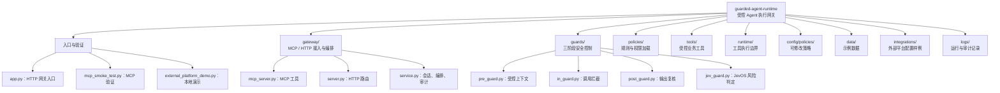

# 项目结构与文件职责

## 根目录

| 文件/目录 | 作用 |
| --- | --- |
| `README.md` | 项目介绍、JevOS 启动、MCP/HTTP 接入与排错。 |
| `PROJECT_STRUCTURE.md` | 本文档。 |
| `app.py` | 启动 HTTP 网关。 |
| `mcp_smoke_test.py` | 验证 MCP 服务与报销 Demo。 |
| `external_platform_demo.py` | 演示正常审核和违规拦截。 |
| `requirements.txt` | Python 依赖。 |
| `gateway/` | 对外协议、会话和任务编排。 |
| `guards/` | Pre / In / Post Guard 与 JevOS 风险判断。 |
| `policies/` | 策略配置加载、权限和业务规则对象。 |
| `tools/` | 工具注册表与报销 Demo 工具。 |
| `runtime/` | 工具调用数据结构和执行边界。 |
| `config/policies/` | 可直接修改的 JSON 策略。 |
| `data/` | Demo 数据。 |
| `integrations/` | 外部 Agent 平台的接入示例。 |
| `logs/` | 运行日志和审计日志。 |

## gateway/

| 文件 | 作用 |
| --- | --- |
| `mcp_server.py` | 声明 MCP 工具：一站式报销审核、创建受控会话、通用工具代理、输出复核、审计查询和策略重载。 |
| `server.py` | 提供 HTTP 路由，如 `/expense/audit`、`/tools/call`、`/review/output`。 |
| `service.py` | 核心编排：管理 `session_id`、调用 Guard、执行工具、记录审计；提供 `register_tool()` 扩展其他业务工具。 |
| `logging_config.py` | 将文本日志写入 `guard_gateway.log`，结构化事件写入 `audit.jsonl`。 |
| `__init__.py` | Python 包标记。 |

## guards/

| 文件 | 作用 |
| --- | --- |
| `pre_guard.py` | 识别任务，生成权限、工具白名单、禁止动作和 Agent 约束。 |
| `in_guard.py` | 在执行前校验禁止动作、工具白名单、权限和参数 Schema，并调用 JevOS。 |
| `post_guard.py` | 复核最终答案的工具依据、金额一致性、必填字段和越权承诺。 |
| `jev_guard.py` | 调用本机 JevOS `/v1/systemone`，进行付款、预算/发票修改等语义风险判断。 |
| `__init__.py` | Python 包标记。 |

## policies/

| 文件 | 作用 |
| --- | --- |
| `policy_loader.py` | 读取 `config/policies/*.json`。 |
| `permissions.py` | 解析用户、角色、权限和别名。 |
| `rules.py` | 解析报销业务规则。 |
| `guard_policies.py` | 定义 Pre/In/Post/Jev Guard 的配置对象。 |
| `__init__.py` | Python 包标记。 |

## tools/ 与 runtime/

| 文件 | 作用 |
| --- | --- |
| `tools/tool_registry.py` | 定义 `ToolSpec`，注册工具名称、实现函数、所需权限和参数 Schema。 |
| `tools/expense_tools.py` | Demo 报销工具：列单、读单、验票、计算、生成审核意见。 |
| `runtime/executor.py` | `ToolCall`、`ToolResult` 的统一数据结构。 |
| `runtime/sandbox.py` | 统一执行工具并隔离输入参数。 |
| 各目录的 `__init__.py` | Python 包标记。 |

## config/policies/

| 文件 | 作用 |
| --- | --- |
| `users.json` | 用户、角色、权限、用户别名。 |
| `business_rules.json` | 报销限额、费用类型与票据规则。 |
| `pre_guard.json` | 任务关键词、报销任务和通用任务的 Agent 约束。 |
| `in_guard.json` | 禁止动作、白名单、权限和参数校验开关。 |
| `post_guard.json` | 输出必需依据、字段和禁止承诺。 |
| `jev.json` | JevOS 地址、模型、阈值、风险短语和故障策略。 |

## data/、integrations/、logs/

| 文件/目录 | 作用 |
| --- | --- |
| `data/sample_expense.json` | Demo 报销单数据：`EXP-2026-001` 可通过，`EXP-2026-002` 因重复发票和缺失票据被拦截。 |
| `integrations/qwenpaw_mcp_config.example.json` | QwenPaw MCP 配置样例。 |
| `integrations/qwenpaw_agent_instructions.md` | Agent 调用网关工具的指令样例。 |
| `logs/guard_gateway.log` | 可读运行日志。 |
| `logs/audit.jsonl` | 每行一条 JSON 审计事件：会话、工具、参数、放行结果和 Jev 风险结果。 |
